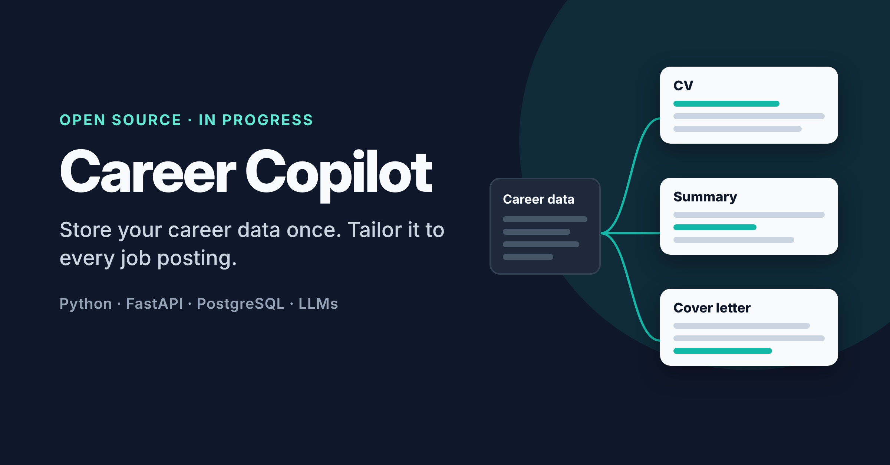
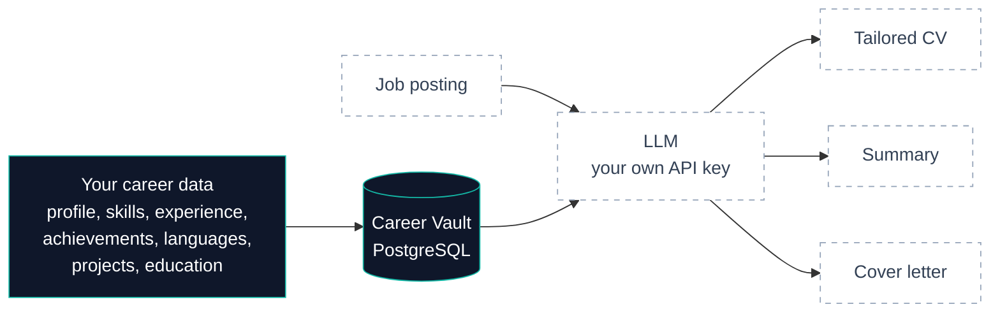
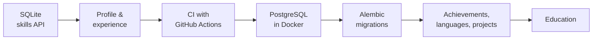

# Career Copilot

Store your career data once. Tailor your CV, summary and cover letter to every job posting.

**Open source · Local-first · Bring your own LLM key · In progress**

## The problem

Job seekers rewrite the same experience for every application. The facts stay the same; only the angle changes for each role.

## How it works

Solid boxes work today. Dashed boxes are next.

## Status

| Works today | Coming next |
|---|---|
| Career Vault API: profile, skills, experience, achievements, languages, projects, education | **Tailoring engine**: CV, summary, cover letter |
| Input validation (Pydantic) | React frontend |
| Database migrations (Alembic), checked in CI | Interview preparation |
| 100+ tests on a separate test database | |
| CI on every pull request (GitHub Actions) | |
| One command to start or check everything (`just`) | |

## Key decisions

| Decision | Why | Trade-off |
|---|---|---|
| **FastAPI** | Validation and API docs come from type hints | No built-in auth or migrations |
| **PostgreSQL in Docker** | Vector search (`pgvector`) for the AI features, real foreign keys | Docker must be running |
| **Alembic migrations, run outside the app** | Schema changes keep the data; CI fails if a model has no migration | One more step before starting the app |
| **UUID ids** | Data can move between machines without id clashes | Harder to read while debugging |
| **Tests through the API** | Tests check what the client actually receives | Slower than testing schemas directly |

Every decision is explained in [`docs/adr/`](docs/adr/).

## How it evolved

I started with SQLite for zero setup, then moved to PostgreSQL once the AI plans needed vector search ([ADR 0014](docs/adr/0014-use-postgresql-in-docker.md)).

## Limitations

- API only for now: try it at `/docs`.
- No AI features yet.
- Single user, no login, by design
