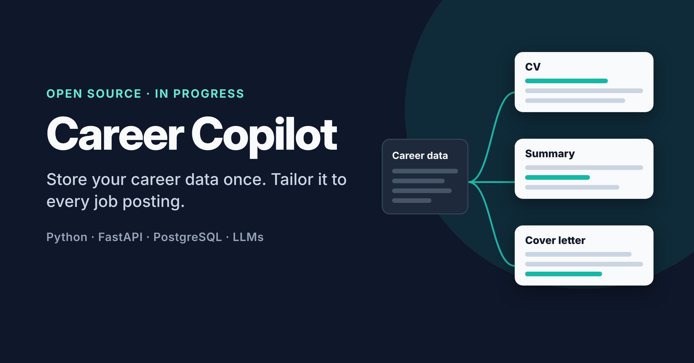
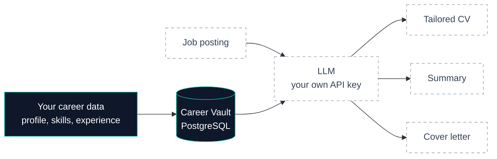
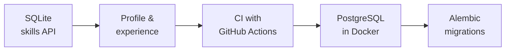

# Career Copilot



Store your career data once. Tailor your CV, summary and cover letter to every job posting.

**Open source · Local-first · Bring your own LLM key · In progress**

## The problem

Job seekers rewrite the same experience for every application. The facts stay the same; only the angle changes for each role.

## How it works



Solid boxes work today. Dashed boxes are next.

## Status

| Works today | Coming next |
|---|---|
| Career Vault API: profile, skills, experience | Achievements, projects, education |
| Input validation (Pydantic) | **Tailoring engine**: CV, summary, cover letter |
| Database migrations (Alembic), checked in CI | React frontend |
| 50+ tests on a separate test database | Interview preparation |
| CI on every pull request (GitHub Actions) | |

## Key decisions

| Decision | Why | Trade-off |
|---|---|---|
| **FastAPI** | Validation and API docs come from type hints | No built-in auth or migrations |
| **PostgreSQL in Docker** | Vector search (`pgvector`) for the AI features, real foreign keys | Docker must be running |
| **Alembic migrations, run outside the app** | Schema changes keep the data; CI fails if a model has no migration | One more step before starting the app |
| **UUID ids** | Data can move between machines without id clashes | Harder to read while debugging |
| **Tests through the API** | Tests check what the client actually receives | Slower than testing schemas directly |

Every decision is explained in [`docs/adr/`](docs/adr/).

## How it evolved



I started with SQLite for zero setup, then moved to PostgreSQL once the AI plans needed vector search ([ADR 0014](docs/adr/0014-use-postgresql-in-docker.md)).

## Limitations

- API only for now: try it at `/docs`.
- No AI features yet.
- Single user, no login, by design for a local app.

## Run it locally

Requires Docker, [uv](https://docs.astral.sh/uv/) and [just](https://just.systems/) (`uv tool install rust-just`).

```bash
cp backend/.env.example backend/.env    # then set your own password
just up       # start PostgreSQL and apply the migrations
just dev      # run the API; docs at http://127.0.0.1:8000/docs
just check    # format, lint and test
```

Run `just` to list all commands.

How tests are written: [`docs/testing.md`](docs/testing.md)

## Tech stack

Python 3.12 · FastAPI · Pydantic v2 · SQLAlchemy 2 · PostgreSQL · Docker Compose · uv · just · pytest · ruff · GitHub Actions
