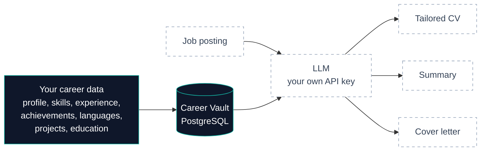
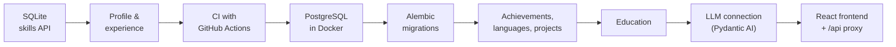

# Career Copilot


Store your career data once. Tailor your CV, summary and cover letter to every job posting.

**Open source · Local-first · Bring your own LLM key · In progress**

## The problem

Job seekers rewrite the same experience for every application. The facts stay the same; only the angle changes for each role.

## How it works



Solid boxes work today. Dashed boxes are next.

## Status

| Works today | Coming next |
|---|---|
| Career Vault API: profile, skills, experience, achievements, languages, projects, education | Vault pages in the frontend |
| LLM connection for any supported provider (Pydantic AI) | CV upload that fills the vault |
| React frontend set up (Vite, TypeScript), API under `/api` behind a proxy | **Tailoring engine**: CV, summary, cover letter |
| Input validation (Pydantic) | Interview preparation |
| Database migrations (Alembic), checked in CI | |
| 100+ tests on a separate test database | |
| CI on every pull request for backend and frontend (GitHub Actions) | |
| One command to start or check everything (`just`) | |

## Key decisions

| Decision | Why | Trade-off |
|---|---|---|
| **FastAPI** | Validation and API docs come from type hints | No built-in auth or migrations |
| **PostgreSQL in Docker** | Vector search (`pgvector`) for the AI features, real foreign keys | Docker must be running |
| **Alembic migrations, run outside the app** | Schema changes keep the data; CI fails if a model has no migration | One more step before starting the app |
| **UUID ids** | Data can move between machines without id clashes | Harder to read while debugging |
| **Tests through the API** | Tests check what the client actually receives | Slower than testing schemas directly |
| **Pydantic AI for the LLM** | Any supported provider with one set of settings; answers are checked against schemas | Larger install; a major-version upgrade is expected |
| **React + Vite single-page app** | FastAPI is already the server; the API types will be generated from its schema | Node.js is needed next to Python |
| **API under `/api` behind a proxy** | The browser sees one origin, so no CORS; page URLs and API URLs never clash | Production needs a reverse proxy |

Every decision is explained in [`docs/adr/`](docs/adr/).

## How it evolved



I started with SQLite for zero setup, then moved to PostgreSQL once the AI plans needed vector search ([ADR 0014](docs/adr/0014-use-postgresql-in-docker.md)).

## Limitations

- No vault pages yet: the frontend shows a start page; use the API at `/docs`.
- The LLM connection is in place, but no AI feature uses it yet.
- Single user, no login, by design for a local app.

## Run it locally

Requires Docker, [uv](https://docs.astral.sh/uv/), [just](https://just.systems/) (`uv tool install rust-just`) and Node.js 26 (version in `frontend/.nvmrc`).

```bash
cp backend/.env.example backend/.env    # then set your own password, and an LLM if you want one
just up             # start PostgreSQL and apply the migrations
just dev            # run the API; docs at http://127.0.0.1:8000/docs
just check          # lint, format and test the backend

just web-install    # install the frontend packages exactly as locked
just web            # run the frontend at http://localhost:5173 (needs just dev for /api)
just web-check      # lint, format and build the frontend
```

Run `just` to list all commands.

How tests are written: [`docs/testing.md`](docs/testing.md)

## Tech stack

Python 3.12 · FastAPI · Pydantic v2 · SQLAlchemy 2 · PostgreSQL · Pydantic AI · Docker Compose · uv · just · pytest · ruff · GitHub Actions

React · TypeScript · Vite · Biome · npm
